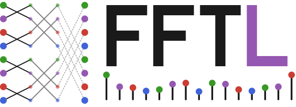

# FFTL.jl

*Fastest Fourier Transform in Lübeck*: a Fourier transform library in pure Julia. Complex, real
and real-to-real transforms of `Float32` and `Float64` arrays, any number of dimensions, any
length, several threads, SIMD on the CPU, KernelAbstractions on GPUs, and a C library
([`libfftl`](@ref "C library (libfftl)")) compiled from the same code.

!!! warning "Experimental"
    FFTL.jl is under development and not registered yet. The interface can still change; the
    documented parts are the ones tested in CI.

## What you get

- **Every transform you use.** Complex, real-input and all eleven real-to-real kinds (DCT-I to
  DCT-IV, DST-I to DST-IV, Hartley, halfcomplex), along any set of dimensions of any rank.
- **Any length.** Smooth lengths go through codelets; lengths with large prime factors go through
  Bluestein's algorithm. No padding to powers of two.
- **Plans that behave like the rest of the ecosystem.** Every plan is an `AbstractFFTs.Plan`:
  `mul!`, `*`, `inv`, `\`. See [Using FFTL next to FFTW.jl](@ref "Using FFTL next to FFTW.jl").
- **Parallel where it pays.** Threads are used only when the transform is large enough, and a
  single long line uses the four-step algorithm. See [Threads](@ref "Threads").
- **Numbers in their own precision.** `BigFloat` and other floating-point types are transformed
  in that type, not converted to `Float64`.
- **A C library without a Julia installation.** [libfftl](@ref "C library (libfftl)") is FFTL
  trimmed with `juliac`, with the same transforms in single and double precision.

## Quick start

```@example home
using FFTL, LinearAlgebra

x = randn(ComplexF64, 1000, 1000)
y = FFTL.fft(x)                  # all dimensions, unnormalised
x2 = FFTL.ifft(y)                # normalised inverse
x2 ≈ x
```

```@example home
p = FFTL.plan_fft(x)             # a plan holds the work buffers and tables
mul!(y, p, x)                    # apply it, as often as you like
y ≈ FFTL.fft(x)
```

```@example home
r = randn(1000, 1000)
R = FFTL.rfft(r)                 # half spectrum along dimension 1: 501 × 1000
FFTL.irfft(R, 1000) ≈ r
```

```@example home
C = FFTL.dct(r)                  # orthonormal DCT-II; idct inverts it
FFTL.idct(C) ≈ r
```

## Where to go

| If you want to | read |
|:--|:--|
| run your first transform | [Your first transform](@ref "Your first transform") |
| see the library used on real problems | [Tutorials](@ref "Spectrum of a sampled signal") |
| solve a specific task: plans, real data, threads, GPUs, C | [How-to Guides](@ref "Plans and reuse") |
| understand the mathematics and the algorithms | [Explanation](@ref "The discrete Fourier transform") |
| look up a function, a kind, a limit | [Reference](@ref "Julia API") |

## Design in one paragraph

A plan is a Julia object that carries the radix sequence, the twiddle tables and the work
buffers for one size and one set of dimensions. Radix sequences are chosen by a fixed rule, and
the codelets they run are generated for the radix, element type and SIMD width actually used. Long transforms run on several threads, and
lengths with large prime factors go through Bluestein's algorithm. The details are in
[Explanation](@ref "Algorithms").

## Package status

| | |
|:--|:--|
| Julia | 1.10 and newer (CI: 1.10 and current) |
| License | MIT |
| Interface | `AbstractFFTs.Plan`s with `mul!`, `*`, `\` and `inv`; the functions are called as `FFTL.fft` |
| Platforms | Linux and macOS (CI); Apple M1 Max is the development machine |
| GPU | experimental, via KernelAbstractions.jl |
| C library | experimental, `juliac --trim`, see [libfftl](@ref "C library (libfftl)") |

The complete matrix of transforms, number types and platforms is in
[Platforms and limits](@ref "Platforms and limits").
